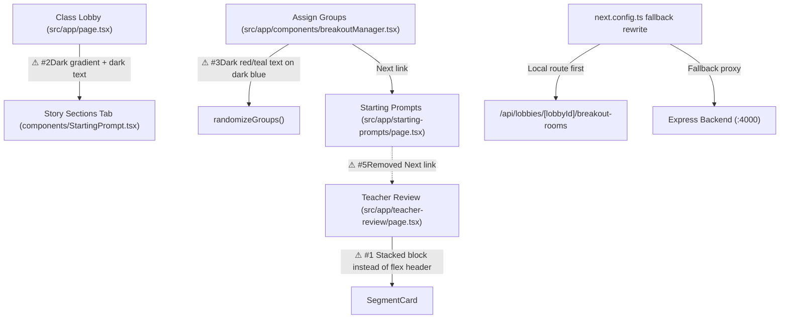

# PR Review — PR #34 Update Teacher Review, Starting Prompts, and Class Lobby UI

- Source: PR #34 `feature/teacher-screen-updates` -> `main` | requirements: none
- Summary: PR #34 updates the UI styling for Teacher Review (R14), Assign Starting Prompts (R12), Class Lobby (S4), and Assign Groups (R20), and moves Next.js API rewrites to a `fallback` list. PR #34 branches directly from `origin/main` (`1a9e6a60`) and has zero Git merge conflicts against `main`. However, it introduces UI layout regressions, dark-background text contrast bugs, a workflow navigation gap, and cross-PR merge conflicts with PR #22 and PR #38.

## Diagrams



## Requirements coverage (optional)
None (general review)

## Merge conflict status against `main`

- **Git merge against `origin/main` (`1a9e6a60`):** **0 Git conflicts (`MERGEABLE`)**. `feature/teacher-screen-updates` is fast-forwardable on top of `origin/main`.
- **Cross-PR conflicts if merged before other open PRs:**
  - **PR #22 (`feature/r20-random-breakout-rooms`):** Conflicts in `src/app/components/breakoutManager.tsx` because both PRs add random group assignment logic (`randomizeGroups` in PR #34 vs `assignRandomRooms` / `/api/lobbies/:lobbyId/random-breakout-rooms` in PR #22).
  - **PR #38 (`develop/supabase-cleanup`):** Conflicts in `components/StartingPrompt.tsx`, `src/app/page.tsx`, and `src/app/teacher-review/page.tsx`.

## Critical fixes

### 1. Restore flex layout on `SegmentCard` header — `src/app/teacher-review/page.tsx:186`
- Problem: The header row inside `SegmentCard` changed from `flex flex-wrap items-center justify-between gap-3` to `mt-4 whitespace-pre-wrap break-words border border-[#134780] bg-[#f5f2ec] p-5 leading-relaxed text-slate-900`. That class string belongs to a story content box, not a header bar. It adds unwanted top margin (`mt-4`) at the top of the card and stacks the section title and status badge without spacing.
- Before:
```tsx
// src/app/teacher-review/page.tsx:185-193
      <article className="min-w-0 rounded-xl border-[3px] border-[#7898bd] bg-[#f0e8db] p-5 text-[#134780] shadow-lg sm:p-6">
        <div className="mt-4 whitespace-pre-wrap break-words border border-[#134780] bg-[#f5f2ec] p-5 leading-relaxed text-slate-900">
          <p className="text-sm font-semibold">
            {formatSection(segment.section) || `Part ${segment.order}`}
          </p>
          <span className="rounded-full bg-white px-3 py-1 text-xs font-semibold">
            {approved ? "Approved" : "Awaiting review"}
          </span>
        </div>
```
Current behavior: The section label and approval badge render inside a padded text box with `mt-4` at the top of the card instead of a horizontal header row.
- After:
```tsx
// src/app/teacher-review/page.tsx:185-193
      <article className="min-w-0 rounded-xl border-[3px] border-[#7898bd] bg-[#f0e8db] p-5 text-[#134780] shadow-lg sm:p-6">
        <div className="flex flex-wrap items-center justify-between gap-3">
          <p className="text-sm font-semibold">
            {formatSection(segment.section) || `Part ${segment.order}`}
          </p>
          <span className="rounded-full bg-white px-3 py-1 text-xs font-semibold">
            {approved ? "Approved" : "Awaiting review"}
          </span>
        </div>
```
New behavior: The section title and approval status badge align on opposite sides of the card header.
- Outcome: Fixes the broken header alignment and duplicate content-box border in `SegmentCard`.

### 2. Fix low-contrast text on dark gradient background — `src/app/page.tsx:545`
- Problem: `src/app/page.tsx:448` changes `<main>` to a dark navy gradient (`bg-gradient-to-b from-[#0e102a] via-[#13204a] to-[#134780]`), but the loading status text at line 545 still uses `text-slate-500`, which is nearly invisible against the dark background.
- Before:
```tsx
// src/app/page.tsx:544-548
            {loading && (
              <p role="status" className="text-sm text-slate-500">
                Connecting to your classroom...
              </p>
            )}
```
Current behavior: "Connecting to your classroom..." renders in dark gray (`text-slate-500`) directly on top of the dark navy `<main>` background.
- After:
```tsx
// src/app/page.tsx:544-548
            {loading && (
              <p role="status" className="text-sm text-slate-200">
                Connecting to your classroom...
              </p>
            )}
```
New behavior: The loading indicator renders in light gray (`text-slate-200`) with readable contrast on the dark background.
- Outcome: Restores WCAG text contrast on the Class Lobby loading state.

### 3. Fix unreadable error, warning, and link colors on dark background — `src/app/components/breakoutManager.tsx:168`
- Problem: `BreakoutManager` changes the background from light blue (`bg-[#C7D7EB]`) to a dark navy gradient (`from-[#0e102a] via-[#13204a] to-[#134790]`), but keeps dark text colors on top of the dark background:
  1. Line 168: `<Link className="font-bold" href="/">` has no text color class and defaults to dark text on the `#0e102a` background.
  2. Line 173: `{error && <p className="text-[#581616]">{error}</p>}` renders dark maroon text on the dark navy background.
  3. Line 177: `<p className="text-[#004E68] ">` renders dark teal text on the dark navy background.
  4. Line 264: The `<select>` inside room cards has no background or text color class, inheriting `text-white` on a browser-default white `<option>` list.
- Before:
```tsx
// src/app/components/breakoutManager.tsx:166-178
            <div>
                <Link className="font-bold"
                 href="/"> {"←"} Return </Link>
            </div>
        <div className="min-h-[75vh] space-y-4 border-4 border-[#d5def0] p-5 text-center text-white sm:p-8">
            {error && <p className="text-[#581616]">{error}</p>}
            {saving && <p> saving...</p>}
            
            {tooSmall && rooms.length > 0 && (
                <p className="text-[#004E68] ">Each room needs at least 2 students before saving.</p>
            )}
```
Current behavior: The return link, error message, and minimum-student warning are dark-on-dark and unreadable.
- After:
```tsx
// src/app/components/breakoutManager.tsx:166-178
            <div className="mb-3">
                <Link className="font-bold text-white hover:underline"
                 href="/"> {"←"} Return </Link>
            </div>
        <div className="min-h-[75vh] space-y-4 border-4 border-[#d5def0] p-5 text-center text-white sm:p-8">
            {error && <p role="alert" className="font-semibold text-rose-300">{error}</p>}
            {saving && <p>saving...</p>}
            
            {tooSmall && rooms.length > 0 && (
                <p className="font-semibold text-amber-200">Each room needs at least 2 students before saving.</p>
            )}
```
New behavior: The return link, error text, and warning text use high-contrast light colors (`text-white`, `text-rose-300`, `text-amber-200`).
- Outcome: Makes error and validation states readable on the new dark gradient theme.

## Optional improvements

### 4. Match error/loading state background in Teacher Review — `src/app/teacher-review/page.tsx:60`
- Problem: The loaded view of `TeacherReviewPage` uses the new gradient and outline (`bg-gradient-to-b from-[#0e102a] via-[#13204a] to-[#134780] ... outline-[#d5def0]`), while the loading/error return branch at line 60 still uses the old flat `bg-[#1e4d85]`.
- Before:
```tsx
// src/app/teacher-review/page.tsx:58-62
  if (loadError || !segments) {
    return (
      <main className="min-h-screen bg-[#1e4d85] px-4 py-8 text-white sm:px-8">
        <div role="status" className="mx-auto max-w-6xl">
```
Current behavior: The screen flashes from flat `#1e4d85` during load to the dark navy gradient with a border outline once loaded.
- After:
```tsx
// src/app/teacher-review/page.tsx:58-62
  if (loadError || !segments) {
    return (
      <main className="min-h-screen bg-gradient-to-b from-[#0e102a] via-[#13204a] to-[#134780] p-6 text-white outline outline-4 -outline-offset-[12px] outline-[#d5def0] sm:p-8">
        <div role="status" className="mx-auto max-w-6xl">
```
New behavior: Both loading/error and loaded states share the same background gradient and frame outline.
- Outcome: Eliminates visual flash during page load.

### 5. Keep forward navigation link from Starting Prompts to Teacher Review — `src/app/starting-prompts/page.tsx:20`
- Problem: `src/app/starting-prompts/page.tsx` adds a back link to `/manually-assigned`, but deletes the forward link (`Next: Teacher Review →` to `/teacher-review`) that existed on `main`.
- Before:
```tsx
// src/app/starting-prompts/page.tsx:20-24
        <div className="mx-auto mt-10 max-w-lg">
          <StartingPrompt />
        </div>
      </div>
```
Current behavior: Teachers can go back to `/manually-assigned`, but have no link to proceed to `/teacher-review`.
- After:
```tsx
// src/app/starting-prompts/page.tsx:20-29
        <div className="mx-auto mt-10 max-w-lg">
          <StartingPrompt />
          <div className="mt-6 flex justify-end">
            <Link
              href="/teacher-review"
              className="rounded-lg border-2 border-[#f4b657] bg-[#f0e8db] px-4 py-2 font-semibold text-[#134780] hover:bg-white"
            >
              Next: Teacher Review →
            </Link>
          </div>
        </div>
      </div>
```
New behavior: Restores the forward navigation link styled to match the new Figma palette.
- Outcome: Preserves the demo flow from Assign Groups -> Starting Prompts -> Teacher Review.

## Better approach
- Root cause: PR #34 applies Figma colors and layout updates across four screens, plus adds an inline `randomizeGroups` helper in `BreakoutManager`, without extracting shared theme tokens or coordinating with open PR #22 (`feature/r20-random-breakout-rooms`).
- Alternatives:
  1. **Keep `randomizeGroups` inline in `BreakoutManager` (Current PR #34)** | Pros: No extra files, works immediately with local `/api/lobbies/[lobbyId]/breakout-rooms` route | Cons: Duplicates PR #22 (`lib/randomBreakoutRooms.ts`) and lacks unit tests | Effort: S | Risk: Low against `main`, medium conflict with PR #22.
  2. **Extract random group assignment to a pure helper and add unit tests** | Pros: Testable, matches `__tests__/breakoutRooms.test.ts` pattern, easy to reconcile with PR #22 | Cons: Small refactor | Effort: S | Risk: Low.
- Recommendation: Option 2 (or merge PR #34 first and close/rebase PR #22), and fix Critical fixes #1–#3 before merging.
- Hidden impact: Changing `next.config.ts` rewrites to `fallback` means any route under `src/app/api/**` now takes precedence over the Express backend (`http://127.0.0.1:4000`). Specifically, `/api/lobbies/[lobbyId]/breakout-rooms`, `/api/lobby/join`, and `/api/starting-prompts` will be served by Next.js route handlers rather than proxied to Express.

## Other checks
- Positive callouts:
  - Moving `next.config.ts` rewrites to `fallback` cleanly fixes the route shadowing issue where Next.js `src/app/api/**` routes were bypassed by the proxy rewrite.
  - Adding `readOnly={saving}` on the feedback `<textarea>` in `src/app/teacher-review/page.tsx:211` prevents concurrent edits while a save request is in flight.
  - Using `crypto.randomUUID()` and Fisher-Yates shuffle in `randomizeGroups` distributes students evenly across rooms.
- Typos: Inconsistent indentation in `components/StartingPrompt.tsx:77`, `src/app/components/breakoutManager.tsx:210`, and `src/app/page.tsx:606-610`.
- Security: No new security issues introduced.
- Performance: No performance regressions.
- Design and reuse: Repeated container classes (`min-h-screen bg-gradient-to-b from-[#0e102a] via-[#13204a] to-[#134780]`) and card styles (`border-[#f4b657] bg-[#f0e8db] text-[#134780]`) appear across 4 files and are good candidates for a shared layout wrapper or CSS utility classes.
